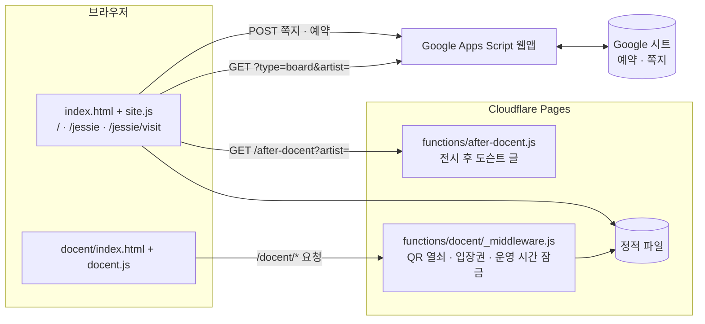

# 조금 이상한 우리들 · Everyone Is a Little off

이즈드로잉 취미미술학원 단체전 **〈조금 이상한 우리들〉**(2026. 11. 12 – 11. 17, 홍대 피시스 아카이브)의 안내 사이트입니다.
관람객에게 전시 정보를 알려 주고, 관람 예약과 작가에게 쪽지 남기기를 받고, 전시장에서는 QR로 여는 오디오 도슨트를 들려줍니다.

- 사이트: <https://a-little-off.pages.dev/>
- 호스팅: Cloudflare Pages (`main` 브랜치에 푸시하면 자동 배포)
- 빌드 과정 없음: HTML · CSS · JS 파일을 그대로 올리는 정적 사이트 + Cloudflare Pages Functions
- 기술 명세(사용 기술 · 구조 · 연동 규격 · 테스트): [docs/SPEC.md](docs/SPEC.md)

---

## 페이지와 기능

| 주소            | 누구를 위한 페이지               | 주요 기능                                                                                                                |
| --------------- | -------------------------------- | ------------------------------------------------------------------------------------------------------------------------ |
| `/`             | 모든 관람객                      | 전시 소개, D-day, 조금 이상한 질문, 전시 안내, 관람 예약, 지금 전시장에는(근무표), 참여 작가, 작가에게 한마디, 링크 공유 |
| `/#이름`        | 특정 작가가 초대한 관람객        | 메인과 같지만, "○○ 작가가 초대합니다" 문구와 그 작가가 미리 골라진 예약 · 쪽지                                           |
| `/jessie`       | 재이(이재이) 작가의 지인         | 작가 전용 페이지: 인사말, 작품과 부분 확대 보기, 쪽지 게시판, 질문, 전시 안내, 예약. 전시가 끝나면 도슨트 글이 공개됨    |
| `/jessie/visit` | 재이 작가가 예약을 부탁하는 지인 | 예약 전용 페이지: 한 화면에 한 장면씩 페이드로 넘어가는 7장면 구성                                                       |
| `/docent`       | 전시장 관람객 (QR)               | 오디오 도슨트 플레이어. 전시장 QR로 들어와야 열리고, 운영 시간에만 열림                                                  |
| `/docent/debug` | 운영진                           | 도슨트 잠금 상태 · 입장권 · 운영 시간 · 음성 파일 점검                                                                   |

### `/` 메인

- **표지와 D-day**: 포스터, 전시 제목, 오픈까지 남은 날 (전시 중에는 "N일차", 끝나면 "종료")
- **조금 이상한 질문**: 전시 서문 · 작품에서 뽑은 질문을 하나씩 보여 줍니다. 이 기기에서 이미 본 질문은 뒤로 미루고 안 본 질문부터 보여 주며, 다 보면 처음부터 다시 돕니다 (`localStorage`의 `alo.seenQuestions`).
- **전시 안내**: 기간, 시간, 입장료, 장소, 주소 복사, 네이버 · 카카오 · 구글 지도
- **관람 예약**: 이름 · 날짜 · 초대한 작가 · 동행 인원 → Google Apps Script를 거쳐 예약 시트에 한 줄로 저장
- **지금 전시장에는**: 전시 기간에만 나타나며, 근무표(코드 안의 CSV)를 읽어 지금 시각에 각 구역을 맡은 사람을 보여 줍니다.
- **참여 작가 · 작가에게 한마디**: 작가를 고르고 쪽지를 남깁니다. 쪽지는 공개되지 않고 전시가 끝난 뒤 작가에게 전해집니다. 단, 게시판을 연 작가(`BOARD_ARTISTS`)에게 쓴 쪽지는 그 작가 페이지 게시판에 붙습니다.
- **함께 보기**: 지금 주소(작가 공유 링크 포함) 복사

### `/jessie` 작가 전용 페이지

- 맨 위 소개 문구 자리에 작가 인사말, 포스터 위에 작가 그림을 살짝 겹쳐 둠
- **이번 전시 작품**: 대표 이미지와 부분 확대 사진. 누르면 전체 화면 뷰어로 넘겨 볼 수 있음
- **남겨 주신 쪽지(게시판)**: Apps Script에서 이 작가에게 온 쪽지를 받아 메모지처럼 붙입니다.
  - 처음 12장, "쪽지 더 보기"로 12장씩 더
  - 기준보다 긴 쪽지는 말줄임표로 접고 누르면 펼침 (기준 = 가장 긴 쪽지를 뺀 평균 글자 수 + 8)
  - ㅋㅋㅋ · 자판 두드리기처럼 내용이 거의 없는 쪽지는 한 치수 작게
  - 보낸 사람이 `HEART_SENDERS`(지금은 "다진고기")면 하트 모양으로, 늘 펼친 채로
- **작품 도슨트**: 전시가 끝난 뒤(11. 17 20:00)에만 서버가 글을 내려 줍니다 (`/after-docent`). 그 전에는 페이지 소스에도 남지 않습니다.
- `/jessie?to=board`로 들어오면 쪽지를 다 불러온 뒤 게시판으로 스크롤합니다 (예약 페이지의 "게시판 보러가기").

### `/jessie/visit` 예약 전용 페이지

페이지 전체가 스크롤되지 않고, 화면에 겹쳐 놓은 7개 장면을 하나씩 **페이드(450ms)** 로 넘깁니다.

1. **표지**: 제목 · 초대 문구 · 포스터. 첫 진입 때만 잠깐 보였다가(진행 막대가 다 차면, 3초) 저절로 전시 안내로 넘어갑니다.
2. **전시 안내**: 전시 기간 달력. 날짜를 누르면 그 날짜가 골라진 채로 예약 장면으로 갑니다. 파란 점은 작가가 하루 종일 있는 날.
3. **관람 예약**: 이름과 날짜만 보이고(기본값: 작가가 있는 11/14), 동행 인원은 눌러야 펼쳐집니다. 초대한 작가는 자동으로 재이.
4. **인사말**
5. **작가에게 한마디**: 쓰는 칸만 있고, 게시판은 "게시판 보러가기"로 `/jessie`에서
6. **조금 이상한 질문**
7. **고맙습니다** + 하단 정보

- 표지와 예약 장면을 뺀 모든 장면의 카드 아래 16px에 "관람 예약하기" 버튼이 있고, 예약을 마치면 "예약 완료 ✓"로 바뀝니다.
- 넘기기: 휠 · 트랙패드, 스와이프, ↑↓ · PageUp/Down · Space, 오른쪽 점. 장면이 화면보다 길면 먼저 그 안에서 스크롤된 뒤 넘어갑니다. 트랙패드 관성으로 여러 장이 넘어가지 않도록 한 번 넘긴 뒤에는 휠 신호가 잠깐 끊길 때까지 기다립니다.
- 글을 입력하는 동안에는 넘기기를 멈춥니다 (키보드가 올라와도 장면이 바뀌지 않게).
- 포스터 · 그림 · 글꼴을 다 받을 때까지는 뒷배경과 "포스터를 불러오는 중이에요" 막대만 보여 주고, 다 받으면 표지 애니메이션을 처음부터 재생합니다. 받는 중에 아래로 넘기면 표지를 건너뛰고 바로 전시 안내로 갑니다.

### `/docent` 오디오 도슨트

- 전시장 QR(`/docent?k=열쇠`)로 들어오면 3시간짜리 입장권 쿠키를 받고, 주소에서 열쇠가 지워집니다.
- 운영 시간(첫날 13:00 개관, 마지막 날 20:00 마감)에만 열립니다.
- 서문부터 에필로그까지 이어 듣기, 작품별 듣기, 재생 속도, 잠금 화면 · 이어폰 버튼(Media Session) 지원
- `/docent#이재이`(본명) 또는 `/docent#재이`(작가명)로 들어오면 그 작가의 도슨트를 바로 불러옵니다. 현장 QR에는 작가 본명이 붙어 있습니다.
- 음성 파일은 `docent/audio/` 아래에 둡니다 (`작가이름.mp3`, `서문.mp3` 등. 순서는 `assets/js/docent-tracks.js`).

---

## 구현 방식

### 한 장의 HTML, 세 가지 주소

`/`, `/jessie`, `/jessie/visit`는 모두 같은 `index.html`입니다. Cloudflare Pages는 `404.html`이 없으면 존재하지 않는 주소에 `index.html`을 내주므로(SPA 대체 동작), 세 주소가 같은 파일을 받고 `assets/js/site.js`가 주소를 읽어 화면을 바꿉니다.

| 주소            | `<html>`에 붙는 class                                  | 결정하는 곳                                                  |
| --------------- | ------------------------------------------------------ | ------------------------------------------------------------ |
| `/jessie`       | `artist-page`                                          | `site.js`의 `PAGE_ARTISTS`                                   |
| `/jessie/visit` | `artist-page` `visit-page` (+ 로딩 중 `visit-loading`) | `site.js`의 `PAGE_VISITS`, `index.html` 머리의 부트 스크립트 |
| 공통            | `anim` (동작 줄이기 설정이 꺼져 있을 때)               | `index.html` 머리의 부트 스크립트                            |

`index.html` 머리에는 첫 화면이 그려지기 전에 class를 붙이는 짧은 스크립트만 인라인으로 두었습니다. 나머지 스크립트는 `body` 맨 끝에서 불러옵니다.

### 데이터가 오가는 길



- **Google Apps Script** (`site.js`의 `SHEET_ENDPOINT`): 쪽지와 예약을 받아 시트에 적고, 게시판을 연 작가의 쪽지 목록을 내려 줍니다. 스크립트 코드는 이 저장소 밖(Google Apps Script 편집기)에 있습니다.
  - 쪽지: `POST { artist, message, sender, at }`
  - 예약: `POST { type: 'reservation', name, date, artist, companions }`. `date`는 시트의 '방문 날짜' 드롭다운 값과 같아야 합니다 (`11/14(토)` 형식).
  - 게시판: `GET ?type=board&artist=이재이` → `{ ok, notes: [{ message, sender, at }] }`
  - 사전 확인 요청(CORS preflight)이 생기지 않도록 `Content-Type: text/plain`으로 보냅니다.
  - 브라우저 쪽에서도 연락처 · 링크가 섞인 글을 거르고, 같은 기기에서 20초 안에 다시 보내는 것을 막습니다.
- **`/after-docent`** (Pages Function): 전시 마감 전에는 `{ ok: false }`만, 마감 뒤에는 작가 도슨트 글을 JSON으로 줍니다. `?k=DOCENT_KEY`를 붙이면 미리 볼 수 있습니다.
- **`/docent/*` 잠금** (Pages Function `_middleware.js` + `[[path]].js`): `/docent` 아래 HTML과 음성 파일은 모두 이 잠금을 거칩니다. 도슨트 페이지의 CSS · JS · 순서표는 `/assets` 아래에 있어 잠기지 않습니다 (작가 · 작품 이름뿐이라 공개돼도 괜찮음).
  - `/docent/__status`: 지금 상태를 JSON으로 (`?at=2026-11-14T15:00`, `?logout=1`)

### Cloudflare Pages 환경 변수

> **값은 저장소에 넣지 않습니다.** 아래는 이름과 용도뿐이고, 실제 값은 Cloudflare Pages → 설정 → 변수 및 비밀에만 있습니다. 테스트는 가짜 값을 쓰고, 로컬 값은 커밋되지 않는 `.dev.vars`에 둡니다.

| 이름                 | 용도                                                                              |
| -------------------- | --------------------------------------------------------------------------------- |
| `DOCENT_KEY`         | QR 주소에 붙는 열쇠, `/after-docent` 미리 보기 열쇠. 바꾸면 이전 QR은 열리지 않음 |
| `DOCENT_SECRET`      | 도슨트 입장권 서명용 비밀값                                                       |
| `DOCENT_ALWAYS_OPEN` | `"true"`면 운영 시간과 상관없이 엶 (리허설용). 전시 첫날 0시에 저절로 무시됨      |

---

## 폴더 구조와 규칙

```
.
├── index.html                메인 · /jessie · /jessie/visit 공용 페이지 (마크업 + 부트 스크립트)
├── docent/
│   ├── index.html            도슨트 플레이어 (잠김)
│   ├── debug.html            도슨트 점검 (잠기지 않음)
│   └── audio/                음성 파일 (잠김)
├── assets/
│   ├── css/
│   │   ├── site.css          index.html 스타일
│   │   ├── docent.css
│   │   └── docent-debug.css
│   ├── js/
│   │   ├── site.js           index.html 동작
│   │   ├── docent.js
│   │   ├── docent-debug.js
│   │   ├── docent-tracks.js  도슨트 순서표 (docent · debug 공용 데이터)
│   │   └── console-greeting.js  개발자도구 콘솔 인사 (모든 페이지 공용)
│   └── img/
│       ├── poster-hero.jpg   표지 포스터
│       └── poster.png        포스터 원본 (사이트에서는 쓰지 않음)
├── works/<작가 주소>/          작가 작품 사진. NN.jpg = 원본, NN-s.jpg = 목록용 작은 사진
├── functions/                Cloudflare Pages Functions (주소 = 파일 경로)
│   ├── after-docent.js       GET /after-docent
│   └── docent/
│       ├── _middleware.js    /docent/* 잠금
│       └── [[path]].js       /docent/* 를 모두 잠금으로 보내는 통로
├── _headers                  사진 · 아이콘 캐시 규칙
├── _redirects                README · docs · tests 를 사이트 주소로 열면 첫 화면으로 돌린다
├── robots.txt, sitemap.xml   검색 엔진 안내 (메인만 색인, 작가 페이지 · 도슨트 제외)
├── docs/SPEC.md              기술 명세
├── tests/                    테스트 (따로 package.json 을 둔다. 배포에 영향 없음)
├── og-image.jpg, favicon-*.png, apple-touch-icon.png
│                             링크 미리보기 · 아이콘. 이미 공유된 링크가 이 주소를 쓰므로 루트에 둔다
├── .editorconfig  .prettierrc.json  .prettierignore  .gitignore
└── README.md
```

**규칙**

- **페이지(HTML)** 는 주소 그대로의 위치에 둡니다 (`/docent` → `docent/index.html`). HTML에는 마크업만 두고, 스타일 · 스크립트는 `assets/css`, `assets/js`에 페이지 이름과 같은 파일로 둡니다 (`docent/debug.html` → `docent-debug.css`, `docent-debug.js`). 예외는 첫 화면 깜빡임을 막는 짧은 부트 스크립트 하나뿐입니다.
- **파일 이름**은 소문자 + 하이픈(kebab-case). 여러 페이지가 함께 쓰는 데이터 · 도구도 `assets/js`에 둡니다.
- **주소가 바뀌면 안 되는 파일**(링크 미리보기 이미지, 아이콘, 작품 사진)은 지금 위치를 유지합니다.
- **Cloudflare 예약 위치**(`functions/`, `_headers`, `_redirects`)는 루트에 둡니다.
- **코드 스타일**: 들여쓰기 2칸, LF, UTF-8. 브라우저 스크립트는 오래된 휴대폰을 위해 빌드 없이 돌아가는 ES5 문법(`var`, `function`)을 유지하고, 서버(Functions) 쪽은 최신 문법을 씁니다. 주석은 한국어로, "왜 이렇게 했는지"를 적습니다.
- **포매팅**: 루트에 `package.json`을 두지 않습니다. Cloudflare Pages가 의존성을 설치해 배포물에 섞일 수 있어서입니다(테스트용 `package.json`은 `tests/` 안에만). 고친 뒤에는 아래 명령으로 맞춥니다.

  ```sh
  npx prettier@3.3.3 --write "**/*.{html,css,js,json,md}"
  ```

---

## 자주 고치는 곳

| 하고 싶은 일                           | 고칠 곳                                                                                                 |
| -------------------------------------- | ------------------------------------------------------------------------------------------------------- |
| 근무표(지금 전시장에는) 교체           | `assets/js/site.js`의 `SCHEDULE_CSV`. 구글 시트 '스텝 타임테이블' 탭을 복사해 붙여 넣기                 |
| 조금 이상한 질문 추가 · 수정           | `site.js`의 `QUESTIONS`                                                                                 |
| 참여 작가 명단                         | `index.html`의 `.artists` 목록. 작가명과 본명이 다르면 `<li data-name="본명">작가명</li>`               |
| 작가 전용 페이지 추가                  | `site.js`의 `PAGE_ARTISTS`(주소 → 본명), 작품 사진은 `works/<주소>/`, 표지에 겹칠 그림은 `ARTIST_COVER` |
| 쪽지 게시판을 여는 작가                | `site.js`의 `BOARD_ARTISTS` (Apps Script 쪽 목록과 같아야 함)                                           |
| 하트 쪽지로 보일 사람                  | `site.js`의 `HEART_SENDERS`                                                                             |
| 예약 날짜 목록                         | `site.js`의 `DAYS` (예약 시트 드롭다운 값과 같아야 함)                                                  |
| 예약 페이지 표지 시간 · 장면 전환 속도 | `site.js`의 `AUTO_HIDE`, `FADE`                                                                         |
| 작가가 하루 종일 있는 날               | `site.js`의 `MEET_DAY`                                                                                  |
| 도슨트 순서 · 파일 이름                | `assets/js/docent-tracks.js`                                                                            |
| 도슨트 운영 시간                       | `functions/docent/_middleware.js`의 `HOURS`                                                             |
| 전시 후 공개할 도슨트 글               | `functions/after-docent.js`의 `DOCENTS`                                                                 |

## 로컬에서 보기

정적 파일이라 아무 서버로나 열 수 있습니다. `/jessie` 같은 주소까지 확인하려면 존재하지 않는 주소에 `index.html`을 내주는 서버가 필요하고, Functions까지 확인하려면 Wrangler를 씁니다.

```sh
npx wrangler@3 pages dev .        # http://localhost:8788 (Functions 포함)
```

도슨트를 로컬에서 열려면 `.dev.vars` 파일에 `DOCENT_KEY`, `DOCENT_SECRET`, `DOCENT_ALWAYS_OPEN=true`를 적어 둡니다 (`.gitignore`에 포함되어 있음).

## 테스트

```sh
cd tests
npm install
npx playwright install chromium   # 처음 한 번
npm test                          # 서버 함수 단위 테스트(16) + 브라우저 테스트(33)
```

- `npm run test:unit`: 도슨트 잠금 · 전시 후 도슨트 함수 (`node:test`)
- `npm run test:e2e`: 메인 · 작가 · 예약 · 도슨트 페이지를 휴대폰 크기 크롬으로 (Playwright)
- 네트워크 없이 돌아갑니다. Apps Script · 글꼴은 가짜 응답으로 바꾸고 시각은 고정합니다. 자세한 목록은 [docs/SPEC.md](docs/SPEC.md#9-테스트).
